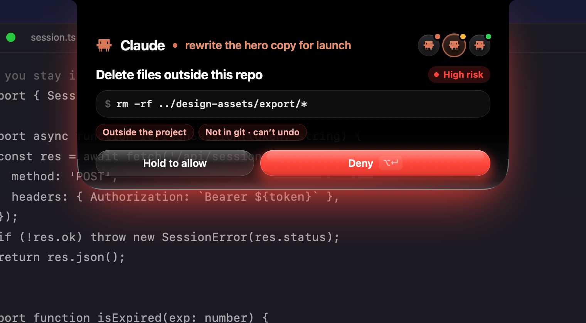
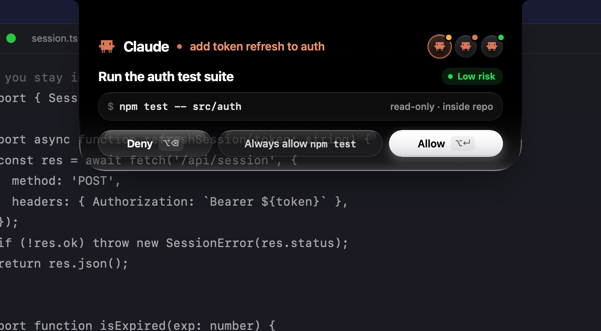
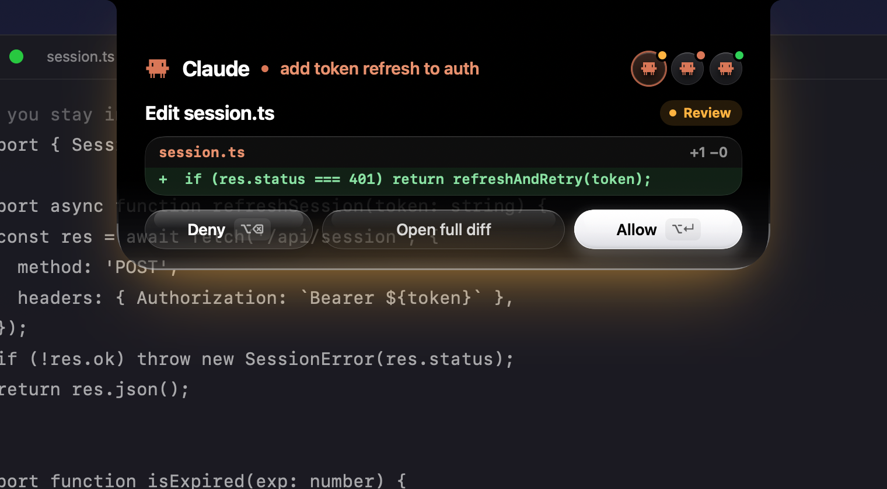
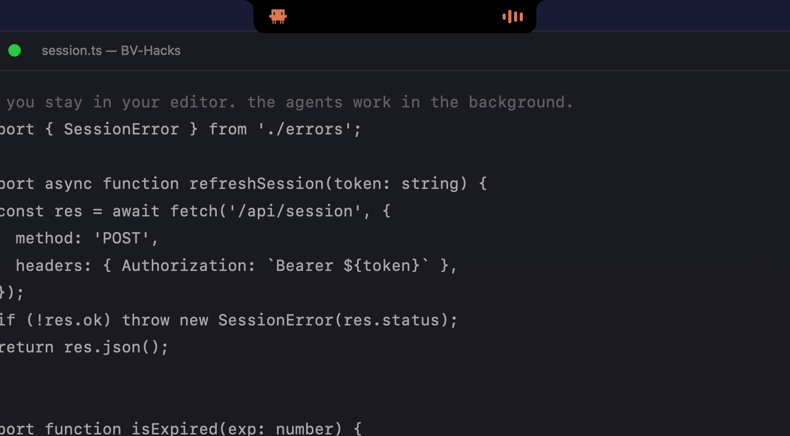
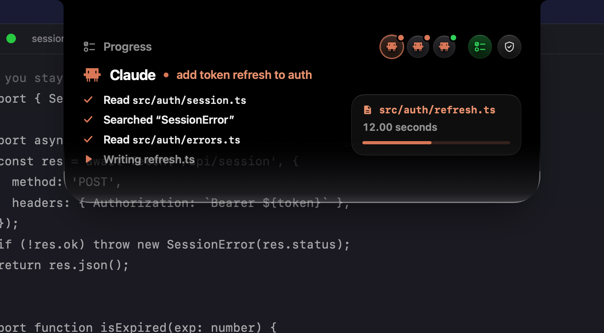
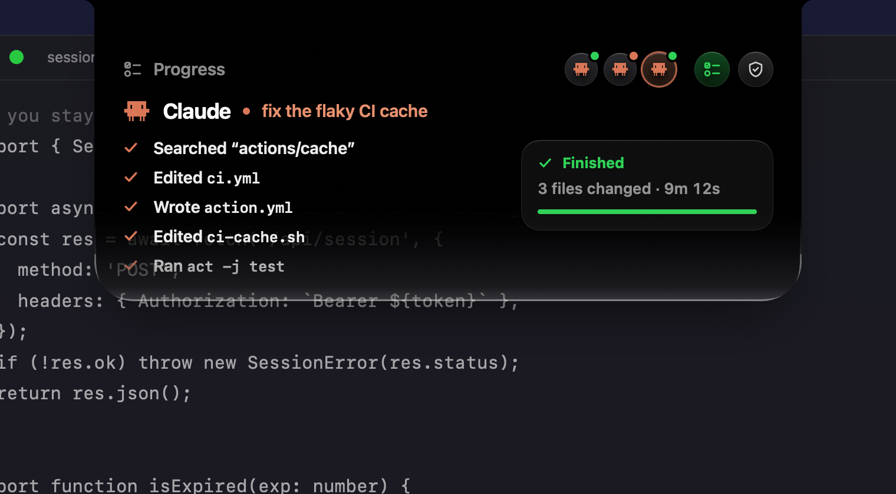

# Nod

**Approve your Claude Code agents from the MacBook notch, with a plain-English read-out of how risky each request is.**



## Why

Running several Claude Code sessions in parallel means each one keeps stopping to ask "run `npm test`?" or "edit
session.ts?", and every answer costs a window switch. Nod moves progress and approvals into the notch. You see what
every agent is doing at a glance, and you answer a request with one keystroke from whatever app you are in.

## Features

- **Live progress.** Collapsed, the notch shows the mascot and a wave while any session works. Hover to open
  Progress: one avatar per session, the last prompt, the completed steps and the current tool with a live timer.
- **Approve or deny from the notch.** Claude Code permission requests appear in the island. Click, or use a global
  hotkey, and the decision goes straight back to Claude Code.
- **Risk read-out.** Every request gets a plain-English title, a level (low, review, high), reason chips, and the
  real diff for edits. The classifier parses the shell command (pipes, `&&`, `$(...)`, `sudo`, `bash -c`,
  `curl | sh`, paths outside the project, secrets files) and never runs or reads anything.
- **Safe defaults for dangerous requests.** High risk glows red, Deny becomes the default action, and allowing takes
  a 0.9 second press-and-hold.
- **Always-allow rules.** "Always allow `npm test`" saves a per-repo rule. Later matches are answered at once and
  counted in the menu. Rules never match compound commands, anything rated high, or anything outside the project.
- **Several sessions.** Requests from all sessions queue up first-in, first-out.
- **Demo mode.** A scripted story plays through the real store and UI without Claude Code.

| Low risk | Review (edit with diff) | High risk |
|---|---|---|
|  |  |  |

| Working | Progress | Finished |
|---|---|---|
|  |  |  |

These images come from the app's own `--snapshot` renderer (offscreen, so the glass uses a gradient fallback). The
design reference is [`docs/design/prototype.html`](docs/design/prototype.html).

## Install

Needs macOS 26 or later, Xcode 26+ (Swift 6.2+), and `jq` for the install scripts.

```sh
scripts/bundle.sh            # release build -> build/Nod.app (menu-bar agent, ad-hoc signed)
open build/Nod.app           # the mascot appears in the menu bar; the island sits on the notch
scripts/install-hooks.sh     # adds Nod's hooks to ~/.claude/settings.json
```

`install-hooks.sh` writes a timestamped backup next to the file first (`settings.json.nod-backup-<date>`), keeps
every unrelated key and hook, refuses invalid JSON, and is safe to run twice. Use `--dry-run` to see the result
without writing, or `--settings PATH` to target another file. The menu item "Install Claude Code hooks…" runs the
same script after a confirmation.

The hooks point at the absolute path of `hooks/nod-hook.sh`. If you move the repo or the app, run the install
script again.

To remove Nod's hooks (and only those):

```sh
scripts/uninstall-hooks.sh
```

## Usage

| Do this | To |
|---|---|
| Hover the notch | open Progress; click an avatar to switch session |
| `⌥↵` (Option-Return) | take the default action: Allow for low and review, **Deny** for high |
| `⌥⌫` (Option-Delete) | deny |
| Press and hold "Hold to allow" for 0.9 s | allow a high-risk request |
| Click "Always allow `<command>`" | allow, and save a rule for this repo |
| Click "Open full diff" | open the file an edit request would change |

The hotkeys are registered only while a request is showing, so they do not shadow other apps the rest of the time.
You can still answer in the terminal: the first answer wins and Nod drops the request.

Rules live in `~/Library/Application Support/Nod/rules.json`. Delete an entry there to remove a rule.

Demo and debugging:

```sh
build/Nod.app/Contents/MacOS/Nod --demo        # play the scripted story (also: menu > Play demo)
scripts/simulate.sh story                      # post fixture hook payloads to a running Nod
build/Nod.app/Contents/MacOS/Nod --snapshot build/snapshots   # render every state to PNG
NOD_LOG=1 NOD_PORT=47480 build/Nod.app/Contents/MacOS/Nod     # debug log, another port
```

## Architecture

```
Claude Code                         Nod.app (menu-bar agent)
-----------                         ------------------------------------------------------
hook event                          HookServer            127.0.0.1:47474, Network.framework
   |  stdin JSON                        |  POST /hook/<Event>
   v                                    v
hooks/nod-hook.sh --- curl ------>  SessionStore          sessions, steps, FIFO request queue
   ^                                    |-- RiskEngine    level, title, reasons, diff preview
   |                                    |-- RulesStore    always-allow rules (auto-answer)
   |                                    v
   |                                IslandModel -> SwiftUI island in a click-through NSPanel
   |                                    ^
   |                                    |  click / Option-Return / Option-Delete / hold
   |   held HTTP response               |
   +---- decision JSON <----------  SessionStore.resolve(...)
```

- `Sources/NodCore`: models, hook contract, risk engine, rules, session store, HTTP server. No UI.
- `Sources/Nod`: the app (panel, island views, hotkeys, demo, snapshots).
- `hooks/nod-hook.sh`: the only thing Claude Code runs. For a `PermissionRequest` the HTTP response is held open
  until you decide, and the hook prints exactly one line:

```json
{"hookSpecificOutput":{"hookEventName":"PermissionRequest","decision":{"behavior":"allow"}}}
{"hookSpecificOutput":{"hookEventName":"PermissionRequest","decision":{"behavior":"deny","message":"Denied from Nod."}}}
```

The full contract is in [`docs/superpowers/plans/hook-contract.md`](docs/superpowers/plans/hook-contract.md) and the
design in [`docs/superpowers/specs/2026-11-15-nod-design.md`](docs/superpowers/specs/2026-11-15-nod-design.md).

## Safety guarantees

- **Nothing is auto-allowed except by a rule you created.** The risk engine only advises.
- **Fail open to Claude Code's own prompt.** If Nod is not running, crashes, or times out, the hook prints nothing
  and exits 0 within milliseconds, and Claude Code asks in the terminal as usual. The hook never exits non-zero.
- **Local only.** The server listens on 127.0.0.1. Nothing leaves the machine.
- **Deny rules still win.** An allow from Nod does not override a deny rule in Claude Code's settings.
- **`AskUserQuestion` and `ExitPlanMode` pass through** to the terminal untouched.
- **Your settings are backed up** before the install or uninstall script changes them.

## Tests

```sh
swift test          # 252 tests: risk engine, rules, formatter, server, store, hook scripts, island model
scripts/e2e.sh      # bundles the app, then drives the real path with nod-hook.sh and checks the decision bytes
```

`scripts/e2e.sh` starts the app with `--test-autodecide`, a test-only flag that answers each request through the
same model actions as the buttons and hotkeys. It uses a private port and a temporary rules file.

## Limitations

- Claude Code only, on a Mac with macOS 26+. Screens without a notch get a simulated one.
- The risk read-out is lexical: it reads the command text, not the disk. It cannot say how many files an `rm`
  would delete, and an unusual command can be rated lower or higher than it deserves. Read the command.
- The terminal prompt stays visible while Nod holds a request; either place can answer.
- Rules have no editing UI yet (the Rules tab in Progress is a placeholder).
- Hook payloads over 1 MB are skipped, so that step is missing from the progress list.
- Not notarized or sandboxed; the bundle is ad-hoc signed for local use.
